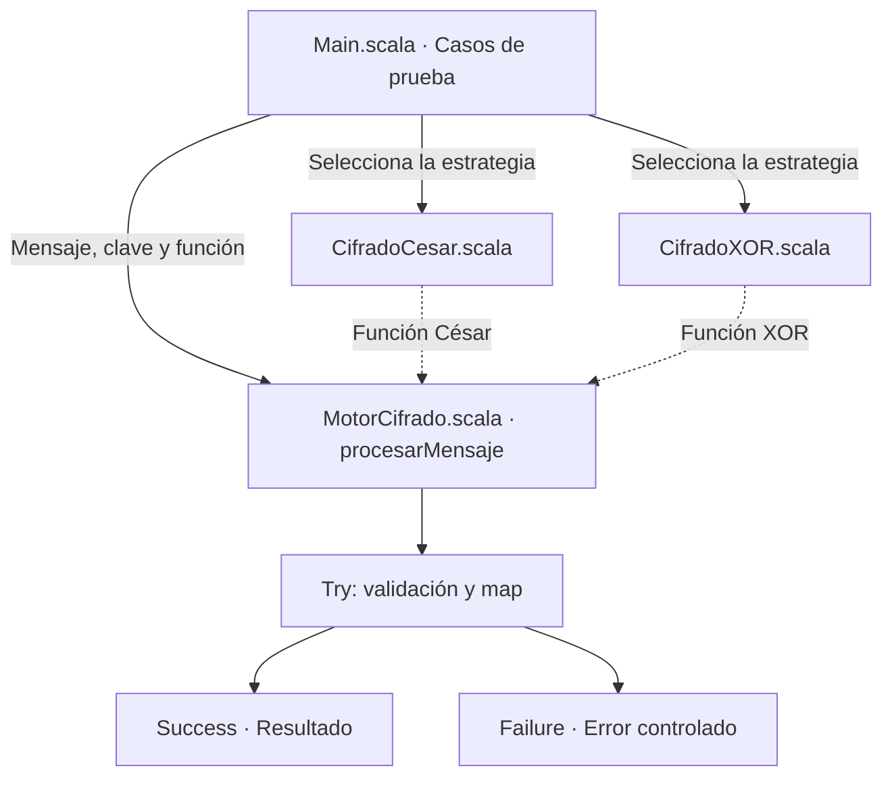

<div align="center">
  <h1>Mini proyecto de criptografía con funciones de orden superior</h1>
    
    
    
  </p>
</div>

## Información académica
| | |   
| :--- | :--- |
| **Carrera** | Computación |
| **Asignatura** | Programación Funcional y Reactiva |
| **Docente** | Ing. Luis Santiago Quiñones Cuenca |
| **Estudiante** | Mateo Sebastián Pardo |
| **Actividad** | Mini proyecto del primer bimestre |
| **Periodo académico** | Octubre 2026 – Febrero 2027 |

## Descripción del proyecto

ScalaCrypto es un programa de consola desarrollado en Scala que permite cifrar y descifrar mensajes mediante los algoritmos César y XOR. Ambos algoritmos se integran en una función de orden superior que recibe el mensaje, una clave numérica y la estrategia de cifrado que se desea aplicar.

El propósito del proyecto es llevar al código los conceptos estudiados durante el primer bimestre, principalmente las funciones anónimas, la inmutabilidad, la transformación de colecciones con `map` y el manejo de excepciones con `Try`. Los algoritmos se utilizan con fines académicos para comprender sus fundamentos matemáticos; no están destinados a proteger información sensible en sistemas reales.

## Objetivos

- Implementar una función de orden superior que permita intercambiar estrategias de cifrado.
- Aplicar las operaciones matemáticas de desplazamiento modular y XOR sobre los caracteres de un mensaje.
- Comprobar el cifrado y descifrado sin modificar los datos originales.
- Controlar los errores producidos por mensajes vacíos o nulos, claves inválidas y caracteres no soportados.

## Arquitectura y organización del código

El proyecto está dividido en cuatro archivos Scala. Cada uno tiene una responsabilidad específica para evitar repetir la lógica de procesamiento y mantener separados los algoritmos de las pruebas realizadas desde la consola.

```text
ScalaCrypto/
├── src/
│   ├── Main.scala
│   ├── MotorCifrado.scala
│   ├── CifradoCesar.scala
│   └── CifradoXOR.scala
├── evidencias/
│   └── EjecuciónPrograma.png
├── .gitignore
└── README.md
```



| Archivo | Responsabilidad |
| :--- | :--- |
| `Main.scala` | Ejecuta los casos de prueba y presenta los resultados mediante pattern matching. |
| `MotorCifrado.scala` | Recibe la estrategia de cifrado como argumento, valida el mensaje y transforma sus caracteres mediante `map`. |
| `CifradoCesar.scala` | Realiza el desplazamiento de las letras dentro del alfabeto. |
| `CifradoXOR.scala` | Aplica la operación XOR utilizando el código ASCII de cada carácter. |

La ventaja de esta estructura es que el motor no depende de un algoritmo específico. Para cambiar la estrategia basta con pasar una función diferente al método `procesarMensaje`, sin modificar su implementación.

## Fundamentos matemáticos

### Cifrado César

El cifrado César desplaza cada letra un número determinado de posiciones en el alfabeto. Ese número corresponde a la **clave**. En este proyecto se consideran las 26 letras del alfabeto latino básico, asignando a cada letra un índice desde 0 hasta 25.

La expresión matemática para cifrar es:

$$E(x,k) = (\operatorname{pos}(x)+k)\bmod 26$$

| Símbolo | Significado |
| :---: | :--- |
| $x$ | Carácter original. |
| $\operatorname{pos}(x)$ | Posición de la letra en el alfabeto. |
| $k$ | Clave que determina el desplazamiento. |
| $26$ | Cantidad de letras utilizadas en el alfabeto. |

Por ejemplo, con la letra **F** y una clave de **3**, la posición inicial de F es 5:

$$E(F,3)=(5+3)\bmod 26=8$$

La posición 8 corresponde a la letra **I**. El mismo procedimiento se realiza sobre todos los caracteres del mensaje.

| Original | F | U | N | C | I | O | N | A | L |
| :--- | :-: | :-: | :-: | :-: | :-: | :-: | :-: | :-: | :-: |
| Cifrado | I | X | Q | F | L | R | Q | D | O |

El módulo permite regresar al inicio del alfabeto cuando se supera la última letra. Por ejemplo, Z con una clave de 3 se convierte en C.

Para descifrar se invierte el desplazamiento:

$$D(y,k)=(\operatorname{pos}(y)-k)\bmod 26$$

En Scala se implementó el cálculo de la siguiente manera:

```scala
val posicion = caracter - base
val desplazamiento = ((posicion + clave) % 26 + 26) % 26
(base + desplazamiento).toChar
```

La variable `base` corresponde a `'A'` o `'a'` según el tipo de letra. Se utiliza un doble módulo porque el operador `%` en Scala puede devolver un residuo negativo cuando la clave es negativa. De esta forma el resultado permanece entre 0 y 25 y se conserva el uso de mayúsculas o minúsculas.

### Cifrado XOR

XOR (Exclusive OR) es una operación lógica que compara dos bits. Devuelve 1 cuando son diferentes y 0 cuando coinciden. En este algoritmo, la clave es un número que se combina con el valor ASCII de cada carácter.

$$E(x,k)=\operatorname{ASCII}(x)\oplus k$$

| Bit A | Bit B | A XOR B |
| :---: | :---: | :---: |
| 0 | 0 | 0 |
| 0 | 1 | 1 |
| 1 | 0 | 1 |
| 1 | 1 | 0 |

Para cifrar la letra `s` con la clave `5`, se parte del código ASCII 115:

```text
Carácter s (115) : 01110011
Clave        (5) : 00000101
                  --------
Resultado   (118): 01110110  → v
```

El proceso aplicado a cada letra de `scala` genera los siguientes valores:

| Carácter | ASCII original | Operación XOR | ASCII resultante | Cifrado |
| :---: | ---: | :---: | ---: | :---: |
| s | 115 | 115 ^ 5 | 118 | v |
| c | 99 | 99 ^ 5 | 102 | f |
| a | 97 | 97 ^ 5 | 100 | d |
| l | 108 | 108 ^ 5 | 105 | i |
| a | 97 | 97 ^ 5 | 100 | d |

XOR tiene la propiedad de ser su propia función inversa:

$$ (a \oplus k)\oplus k=a $$

Por esa razón, para recuperar `scala` se vuelve a aplicar la misma clave `5` sobre `vfdid`. En Scala, esta operación se representa con el operador `^`:

```scala
(caracter.toInt ^ clave).toChar
```

## Aplicación de la programación funcional

### Funciones anónimas y de orden superior

Cada algoritmo se declara como una función de tipo `(Char, Int) => Char`. Este tipo indica que la función recibe un carácter y una clave entera, y devuelve un carácter transformado.

La función `procesarMensaje` recibe cualquiera de estas estrategias:

```scala
def procesarMensaje(
    mensaje: String,
    clave: Int,
    cifrado: (Char, Int) => Char
): Try[String] =
  Try {
    require(mensaje != null, "El mensaje no puede ser nulo")
    require(mensaje.nonEmpty, "El mensaje no puede estar vacío")
    mensaje.map(caracter => cifrado(caracter, clave))
  }
```

Se trata de una función de orden superior porque recibe otra función como parámetro. Por ejemplo:

```scala
procesarMensaje("FUNCIONAL", 3, CifradoCesar.transformar)
procesarMensaje("scala", 5, CifradoXOR.transformar)
```

En ambos casos se utiliza el mismo método de procesamiento; únicamente cambia la estrategia de cifrado.

### Transformación mediante map

`map` recorre los caracteres del mensaje y aplica la función recibida sobre cada uno, generando una nueva cadena. Así se evita utilizar ciclos `for` o modificar el mensaje original mediante variables mutables.

### Manejo de efectos y excepciones

El resultado de `procesarMensaje` es un `Try[String]`. `Try` captura las excepciones producidas durante la validación o el cifrado y permite distinguir dos resultados:

- `Success`: el mensaje pudo procesarse correctamente.
- `Failure`: ocurrió un error y se conserva información sobre la excepción.

Desde `Main.scala`, el resultado se evalúa mediante pattern matching. También se utiliza `flatMap` para ejecutar el descifrado únicamente si el cifrado anterior fue exitoso. De esta manera, un error no obliga a finalizar el programa y las pruebas restantes pueden continuar.

## Ejecución del proyecto

El desarrollo se realizó en GitHub Codespaces con Scala 3, Scala CLI y Visual Studio Code. Para reproducir las pruebas, abrir el repositorio en Codespaces o en un entorno con Scala CLI instalado.

Desde la raíz del repositorio, ejecutar:

```bash
scala-cli run src
```

No se requieren bibliotecas externas.

## Resultados y pruebas realizadas

Las pruebas de `Main.scala` comprueban el cifrado, su operación inversa y la respuesta del programa ante entradas inválidas.

| Algoritmo | Mensaje original | Clave | Mensaje cifrado | Clave de descifrado | Mensaje recuperado |
| :--- | :--- | ---: | :--- | ---: | :--- |
| César | FUNCIONAL | 3 | IXQFLRQDO | -3 | FUNCIONAL |
| XOR | scala | 5 | vfdid | 5 | scala |

### Validación de errores

Se establecieron rangos de claves adecuados para esta implementación: de -25 a 25 para César y de 0 a 127 para XOR. El cifrado César admite letras latinas básicas y XOR admite caracteres ASCII de 7 bits.

| Caso de prueba | Entrada | Resultado obtenido |
| :--- | :--- | :--- |
| Mensaje vacío | `""` | Mensaje rechazado por estar vacío. |
| Mensaje nulo | `null` | Mensaje rechazado por ser nulo. |
| Clave César inválida | `100` | Clave fuera del rango permitido. |
| Clave XOR inválida | `200` | Clave fuera del rango permitido. |
| Carácter no soportado | `SCALA@` | El algoritmo César rechaza `@`. |
| Carácter fuera de ASCII | `ñ` | El algoritmo XOR rechaza el carácter. |

### Evidencia de ejecución

La siguiente captura muestra los resultados reales obtenidos al ejecutar el programa en GitHub Codespaces. Se observan ambos mensajes cifrados, la recuperación de los textos originales y las seis pruebas de manejo de errores sin interrumpir la ejecución.

<div align="center">
  
</div>

## Preguntas de reflexión

### ¿Por qué el método XOR es su propia función inversa utilizando el mismo operador `^`, mientras que el César requiere invertir el signo de la clave?

XOR cancela el efecto de la clave cuando se aplica dos veces sobre un mismo valor. Al cifrar un carácter y aplicar nuevamente XOR con esa clave, se recupera su código ASCII original. En cambio, César realiza un desplazamiento en el alfabeto, por lo que es necesario desplazarse en la dirección contraria para recuperar la letra inicial.

### ¿Qué ventajas ofrece el uso de `map` sobre un bucle `for` tradicional en este contexto?

Con `map` se expresa directamente qué transformación debe aplicarse a cada carácter. No es necesario manejar índices, modificar variables ni construir manualmente el mensaje resultante. El código queda más corto, fácil de entender y se conserva el mensaje original. Además, la misma transformación permite trabajar con ambos algoritmos.

### ¿Cómo ayuda el tipado estático a prevenir errores al pasar funciones como argumentos?

El tipo `(Char, Int) => Char` establece las condiciones que debe cumplir una estrategia de cifrado. Scala comprueba durante la compilación que la función recibida acepte un carácter y un entero y devuelva un carácter. Si se intenta enviar una función con parámetros o un tipo de retorno diferente, el compilador detecta la incompatibilidad antes de ejecutar el programa.

## Conclusión

El desarrollo de ScalaCrypto permitió comprender cómo una función de orden superior puede integrar diferentes algoritmos sin duplicar la lógica principal del programa. La aplicación de `map` facilitó la transformación de los mensajes, mientras que `Try`, `Success` y `Failure` permitieron controlar entradas inválidas. Los resultados obtenidos confirman que ambos algoritmos recuperan correctamente el mensaje original al aplicar su operación inversa.

## Recursos de consulta

- [Documentación oficial de Scala](https://docs.scala-lang.org/)
- [Scala CLI](https://scala-cli.virtuslab.org/)
- [API de Scala: Try](https://www.scala-lang.org/api/3.x/scala/util/Try.html)
